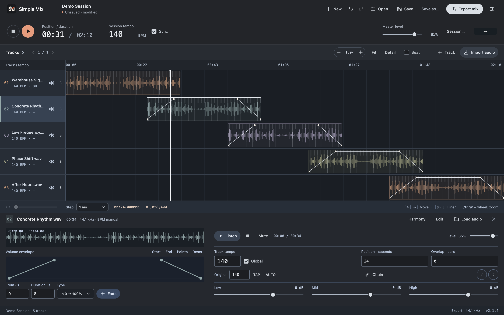

# Simple Mix

Simple Mix is a cross-platform multitrack audio editor for crafting, arranging and mastering mixes. Arrange tracks on a visual timeline, tune their tempo, shape transitions, then export a finished session. The project targets Windows, macOS and Linux.



## Features

- Add multiple audio tracks and arrange them freely on a shared timeline.
- View waveforms, zoom in for beat-level editing, and move one or several tracks precisely.
- Detect BPM automatically, adjust track or session tempo manually, and align beat grids.
- Create multiple volume-fade points and adjust EQ, filters, mute, solo and track gain.
- Estimate musical key and show Camelot-wheel compatibility suggestions.
- Save portable projects with their audio assets, undo and redo edits, and recover recent work.
- Export WAV, FLAC or MP3; optionally normalize or master the final mix.
- Use the interface in English or Spanish.

See the [User Guide](docs/USER_GUIDE.md) for project, editing and export instructions, and the [2.1.4 release notes](docs/RELEASE_NOTES_2.1.4.md) for the current build details.

## Get the app

The current project version is **2.1.4**. Download the Windows, macOS or Linux installer from [GitHub Releases](https://github.com/juan-pujante/simple-mix/releases). Linux releases use the AppImage format. Release notes include platform-specific installation details and checksums.

## Run from source

Requirements: Node.js 22 and npm.

```sh
npm ci
npm start
```

Run the test suites with:

```sh
npm test
```

Build for the current platform with:

```sh
npm run build -- --keep-version
```

Platform-specific packaging and release steps are documented in [Releasing](docs/RELEASING.md). Linux desktop tests require a display; CI runs them under Xvfb.

## Project layout

- `src/main/` contains Electron startup, native integrations, project storage and mastering.
- `src/renderer/` contains the editor interface and application interactions.
- `src/shared/` and `src/workers/` contain shared utilities, translations, analysis and audio workers.
- `tests/` contains desktop, audio and packaging smoke tests; `scripts/` contains build and release tooling.
- `docs/` contains the user guide, release notes, release procedure and third-party notices.

## Technology

Electron, Web Audio, JavaScript and FFmpeg. Audio analysis and rendering run locally; source audio is not uploaded by the application.

Tempo and key detection are estimates and can be corrected manually. Loudness matching is a starting point for balancing tracks; always listen through the complete mix before release. Platform signing and notarization status is listed in each release.

## License

Simple Mix source code is licensed under the [MIT License](LICENSE). Third-party components retain their own licenses; see [Third-Party Notices](docs/THIRD-PARTY-NOTICES.md). The MIT license does not grant rights to music or other media imported into the app.
